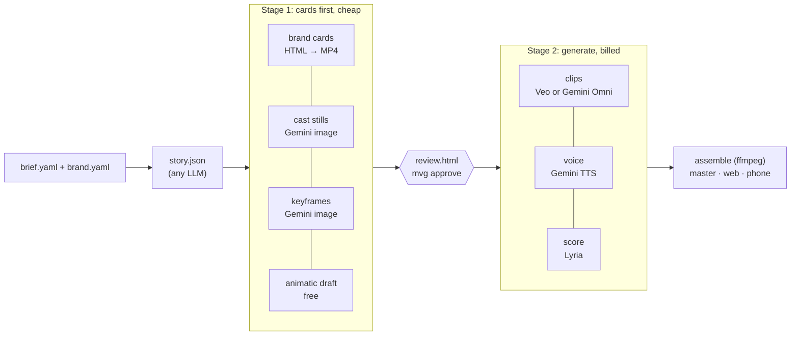

# Multimodal Video Generator using Gemini

**Brief and brand in, finished trailer out.** Write the story with any LLM; then Gemini models on **your own Google
Cloud project** make the cast, keyframes, video, narration and score, and ffmpeg cuts the film. Brand cards come
first and every shot is approved before any video is generated.

**Guided setup (start here):** https://kirankumarduddu.github.io/multimodal-video-generator-gemini/



## Why "cards first"

- **Brand-exact.** Every word, number, product name and logo is rendered from HTML in your colors and fonts. AI
  footage never has to spell anything, so it never misspells it.
- **Cheap to change.** Cards, cast stills and keyframes cost little and show the film before the expensive step.
- **Approved spending.** `mvg clips` animates only shots approved in `approvals.json`. The approval is tied to a hash
  of the shot's prompt, keyframe and model, so a changed shot needs a new approval.
- **Same people in every shot.** One reference still per fictional cast member anchors every keyframe.
- **Timed before it's made.** `mvg clips --animatic` plus placeholder voice and music give a full draft cut at zero
  video cost.

## Quick start

```bash
git clone https://github.com/kirankumarduddu/multimodal-video-generator-gemini.git
cd multimodal-video-generator-gemini
python -m venv .venv
source .venv/bin/activate            # Windows: .\.venv\Scripts\Activate.ps1
pip install -e .
playwright install chromium

./scripts/setup-gcp.sh MY_PROJECT me@example.com     # Windows: .\scripts\setup-gcp.ps1 -Project MY_PROJECT -Email me@example.com

mvg init my-film --example kettle-and-kite   # or: mvg init my-film (blank)
cd my-film                                    # set gcp.project in studio.yaml
mvg doctor                                    # fix every FAIL before spending anything
```

Then, in order:

| Step | Command | What it does | Billed |
| --- | --- | --- | --- |
| Story | `mvg story write` or `mvg story prompt` | The configured LLM writes `story.json`, or you paste the prompt into any chat | LLM |
| | `mvg story check` · `mvg plan` | Validate; show the timeline and what is left to make | |
| Cards | `mvg cards --posters`, then `mvg cards` | Brand check in seconds, then every card and caption as video | |
| Cast | `mvg cast` | One reference still per fictional person | image |
| Keyframes | `mvg keyframes` | The first frame of every live-action shot | image |
| Draft | `mvg clips --animatic` · `mvg voice --placeholder` · `mvg music --placeholder` · `mvg assemble` | A timed draft film (`build/<title>-draft.mp4`) | |
| **Gate** | `mvg review` → `build/review.html` · `mvg approve <ids>` or `--all` | A person approves each shot and its exact prompt | |
| Video | `mvg clips` | Veo or Gemini Omni animates each approved keyframe | video |
| Voice | `mvg voice` | Gemini TTS, one WAV per line | TTS |
| Music | `mvg music` | Lyria, one take per score segment | music |
| Cut | `mvg assemble` | 0.4 s crossfades, captions, voice per scene, score fitted and ducked, −16 LUFS; master + 720p web and phone copies | |

`mvg run` does all of it in order and stops at the approval gate. Every step skips what is up to date; pass scene ids
to limit a step and `--force` to redo it. Every command takes `-C <folder>`.

## Google Cloud: what you need

| Need | Why |
| --- | --- |
| A project with billing | Every model call is billed to it ([pricing](https://cloud.google.com/vertex-ai/generative-ai/pricing)) |
| `aiplatform.googleapis.com` enabled | Gemini, Veo, TTS and Lyria run on Vertex AI |
| `roles/aiplatform.user` for you | Permission `aiplatform.endpoints.predict` to call the models |
| `roles/serviceusage.serviceUsageConsumer` for you | Your Application Default Credentials bill quota to the project |
| `gcloud auth application-default login` + `set-quota-project` | How the CLI authenticates; no keys are stored |
| Optional: a bucket and `roles/storage.objectAdmin` | Only if you set `output.gcs_uri` for Veo output |

`mvg doctor` checks all of it (tools, credentials, quota project, API, IAM, every model id, a real Gemini call, your
story LLM's key) and prints the exact fix for each failure. The guide's step 4 runs the same API, IAM and Gemini checks
**in your browser** with a short-lived token from `gcloud auth print-access-token`; the token stays in the tab's memory.

## The files in a film project

| File | Written by | Holds |
| --- | --- | --- |
| `studio.yaml` | you / the guide | project ID and models: story LLM (`gemini`, `openai`-compatible, `anthropic`, `manual`), image, video (`veo` or `omni`), TTS, music |
| `brand.yaml` | you / the guide | name, tagline, six colors, fonts, logo, look, narrator voice, rules |
| `brief.yaml` | you / the guide | purpose, audience, length, aspect ratio, key message, beats, proof points, CTA, characters, mood |
| `story.json` | any LLM | scenes (cards and live-action shots), cast, voice lines, music segments ([schema](mvgen/schema/story.schema.json)) |
| `approvals.json` | `mvg approve` | the approved hash of each shot |

API keys for other LLMs go in environment variables (`OPENAI_API_KEY`, `ANTHROPIC_API_KEY`, or the name you set in
`api_key_env`), never in files. OpenAI-compatible covers OpenRouter, Groq, Ollama, LM Studio, vLLM and others.

Default models (change them in `studio.yaml`): story `gemini-3.5-flash`, image `gemini-3-pro-image`, video
`veo-3.1-generate-001` (us-central1) or `gemini-omni-1.1-flash-preview` (global), TTS `gemini-3.1-flash-tts-preview`,
music `lyria-3-pro-preview`. Preview models change; `mvg doctor` tells you if an id is not found.

## For LLM agents

[AGENTS.md](AGENTS.md) is the operating guide for coding agents and chat assistants: the questions to ask before
writing, the story rules, the card templates, and the cards-first order with its approval gate.
`docs/llms.txt` summarises the project for LLMs.

## Responsible use

- Only invented, fictional people. The prompts forbid real or famous likenesses; don't work around that.
- Use only logos, screenshots, music references and quotes you have the rights to.
- Generated media can contain mistakes. A person reviews every shot before it is generated and the film before it ships.

## Development

```bash
pip install -e ".[dev]"
python -m pytest -q        # offline: no API calls; the pipeline test renders cards and cuts a draft film
```

The story schema and prompt live in `mvgen/` and are copied to `docs/assets/` for the guide; a test keeps them
identical.

## Author

Kiran Kumar Duddu: AI Architect, Agentic AI Innovator, Healthcare Technology Leader and Open-Source Builder.
Build openly. Engineer responsibly. Make AI useful.
[About](https://kirankumarduddu.github.io/multimodal-video-generator-gemini/about.html) ·
[GitHub](https://github.com/kirankumarduddu)

## License

Apache-2.0. See [LICENSE](LICENSE). Not an official Google product. Gemini, Veo, Lyria and Google Cloud are
trademarks of Google LLC.
